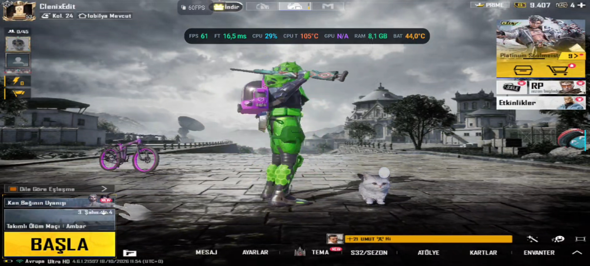
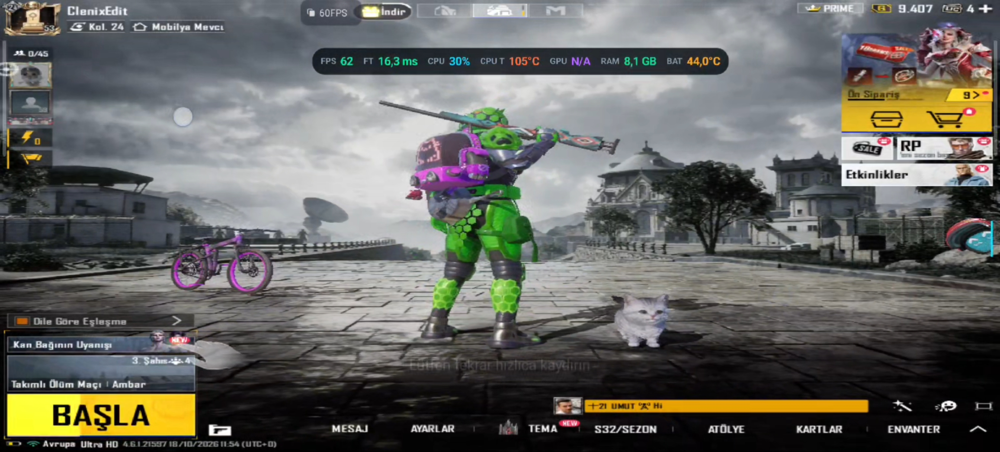
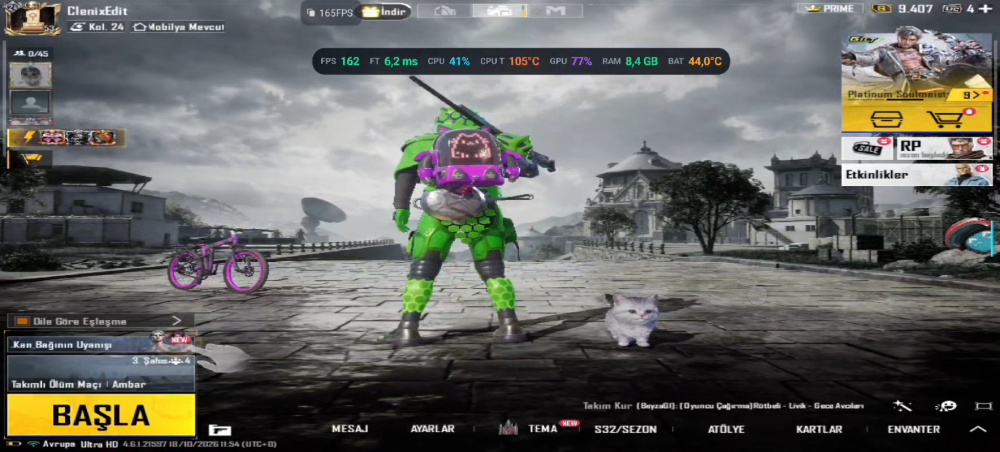
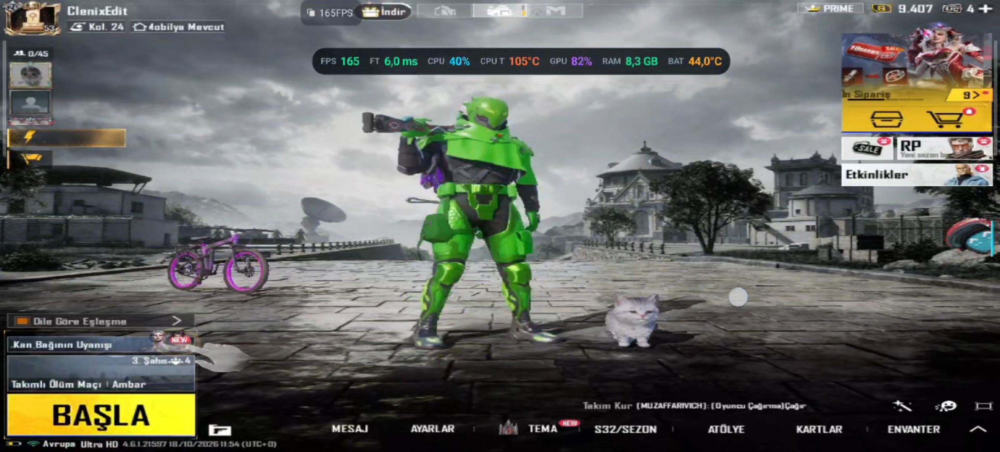
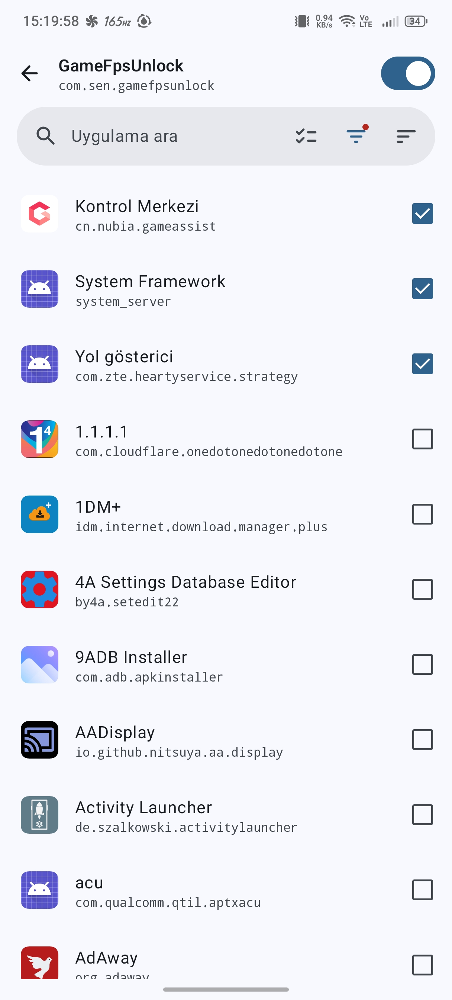

<h1>📱 RedMagic 11 Pro (NX809J) – 165Hz Display Overclock (DTBO)</h1>

  
  
  

This repository provides the modified DTBO (Device Tree Blob Overlay) image to unlock the display refresh rate of the RedMagic 11 Pro (NX809J) from the stock 144Hz to a stable 165Hz.

While the Snapdragon 8 Elite and the RM692H5 panel physically support up to 180Hz, ZTE's proprietary UI framework restricts the display to a maximum of 165Hz. Therefore, this 165Hz mod is the absolute sweet spot for stability, power consumption, and thermal management.

<b>⚠️ DISCLAIMER:</b> 
Modifying system partitions voids your warranty. A bad DTBO flash will cause a bootloop. You MUST have TWRP installed and a full backup of your stock dtbo_b before proceeding. Proceed at your own risk.

<h2>⚙️ Technical Details</h2>

The display refresh rate is tied to the <code>qcom,mdss-mdp-transfer-time-us</code> property in the device tree.

<ul>
  <li><b>Stock 144Hz:</b> 6235 µs (0x185b) -> Byte Clock: ~132.5 MHz</li>
  <li><b>Modded 165Hz:</b> 5454 µs (0x154e) -> Byte Clock: ~150.0 MHz</li>
</ul>

By reducing the MDP transfer time and injecting a new <code>timing@4</code> node, the Qualcomm driver automatically recalculates the DSI clock. Because the panel's DCS <code>0x2f</code> register is set to <code>0x00</code> (Auto/Max), the DDIC automatically steps up to 165Hz. No extra DCS commands are required.

<ul>
  <li>File provided: <code>dtbo_165safe.img</code></li>
  <li>MD5 Hash: <code>2caea2e0f0f03d0d528f3f8da5fb9785</code></li>
</ul>

<h2>📸 Screenshots (With this superior image quality feature module, you can get 165fps in every game.)</h2>

Chronological flashing / verification process (oldest → newest):

   
   
   
   
   
   
   
  

<h2>🎯 Recommended Target List & FPS Boost Settings (PUBG Mobile)</h2>

To achieve the best possible 165 FPS experience in PUBG Mobile, use the following settings. These are the exact selections shown in the screenshots below.

   
  <em>Target List settings – ensure these options are selected.</em>  

   
   
  <em>FPS Boost settings – apply these exact configurations for maximum frame rate.</em>

<h2>🛠️ Prerequisites</h2>

<ol>
  <li>Unlocked Bootloader (Required for TWRP).</li>
  <li>TWRP Custom Recovery installed.</li>
  <li>Root Access (Magisk or KernelSU) - If flashing via Termux.</li>
  <li>Or PC with Fastboot - If flashing via PC.</li>
</ol>

<h2>🚀 Installation Guide</h2>

<h3>Method 1: PC / Fastboot (Recommended)</h3>

<b>Step 1:</b> Download <code>dtbo_165safe.img</code> from the Releases tab.

<b>Step 2:</b> Reboot your device to bootloader:

<pre><code>adb reboot bootloader</code></pre>

<b>Step 3:</b> Flash the DTBO to the active slot (assuming Slot B):

<pre><code>fastboot flash dtbo dtbo_165safe.img</code></pre>

<b>Step 4:</b> Reboot:

<pre><code>fastboot reboot</code></pre>

<h3>Method 2: Termux / Root</h3>

<b>Step 1:</b> Download <code>dtbo_165safe.img</code> and move it to your <code>/sdcard/</code> directory.

<b>Step 2:</b> Open Termux and run (Copy the whole block):

<pre><code>su -c "dd \
if=/sdcard/dtbo_165safe.img \
of=/dev/block/by-name/dtbo_b \
bs=4096 conv=fsync"</code></pre>

<b>Step 3:</b> Sync and reboot:

<pre><code>su -c "sync"
su -c "reboot"</code></pre>

<h2>🔄 How to Recover (Unbrick Guide)</h2>

If your device bootloops, gets stuck on the logo, or shows screen artifacts:

<b>Step 1:</b> Press and hold <b>Volume Up + Power</b> to boot into TWRP.

<b>Step 2:</b> Go to <b>Advanced > Terminal</b>.

<b>Step 3:</b> Restore your stock backup (assuming you backed it up before flashing):

<pre><code>dd \
if=/sdcard/dtbo_b_backup.img \
of=/dev/block/by-name/dtbo_b \
bs=4096 conv=fsync
reboot</code></pre>

(If you didn't make a backup, you will need to flash the stock <code>dtbo.img</code> via Fastboot from the official firmware).

<h2>🤝 Credits</h2>

<ul>
  <li><b>Clenix / Kahraman</b> - Reverse engineering, DTBO analysis, and testing.</li>
  <li>Feel free to open an Issue if you find a way to bypass ZTE's 180Hz lock!</li>
</ul>
